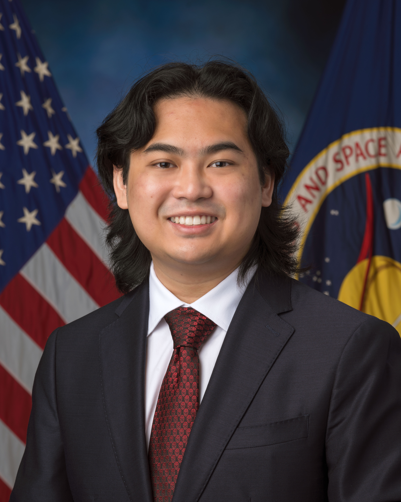

## About Me

Hi, I am Sean! I am an Aerospace engineer currently living in Tokyo.
I graduated from Purude Univeristy with a B.S in Aeronautical and Astronautical Engineering. Previously I worked on spacecraft GNC modeling, simulation, and flight software at NASA Johnson Space Center as a contractor and Airbus U.S Space and Defense.

Welcome to my website!

## Technical Interests

My primary technical interests include:

- **Guidance, Navigation, and Control:** Spacecraft dynamics, attitude control, trajectory optimization, and state estimation.
- **Modeling and Simulation:** Orbital dynamics, numerical integration, Monte Carlo analysis, and software verification.
- **Software Engineering:** C++, Python, MATLAB/Simulink, and scientific computing.
- **Robotics and Autonomy:** Probabilistic estimation, optimization, and autonomous systems.

## Projects

| Year | Project | Description |
|------|---------|-------------|
| 2026 | C++ Orbital Dynamics Simulator | Personal C++23 project exploring spacecraft dynamics, numerical integration, and simulation software architecture. |
| 2026 | NRHO Transfer Optimization | Investigation of Earth-Moon CR3BP transfers under uncertainty using trajectory optimization, Kalman filtering, and Monte Carlo analysis. |
| 2023 | Multi-Agent Valorant Simulator | Agent-based modeling and simulation to predict outcomes in the tactical shooter Valorant. |

For additional information, visit my [Portfolio](/portfolio).

---
## Teaching Experience

During my undergraduate studies, I served as a teaching assistant for Purdue's First-Year Engineering program, supporting the following courses:

- ENGR 131: Transforming Ideas to Innovation I (Fall 2021)
- ENGR 132: Transforming Ideas to Innovation II (Spring 2022)
- ENGR 133: Transforming Ideas to Innovation, EPICS (Fall 2022)
- FYE Computer Lab (Spring 2023)

## Beyond Engineering

Outside of engineering, I enjoy video games, film and television, reading, cooking, and exploring new places. Spider-Man is my favorite super hero, look at my tie above!

Since moving to Japan, I've also been spending time learning Japanese (still awful) and exploring Tokyo.
